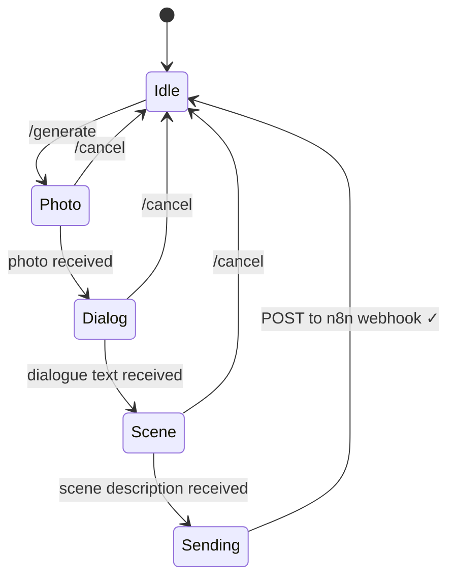
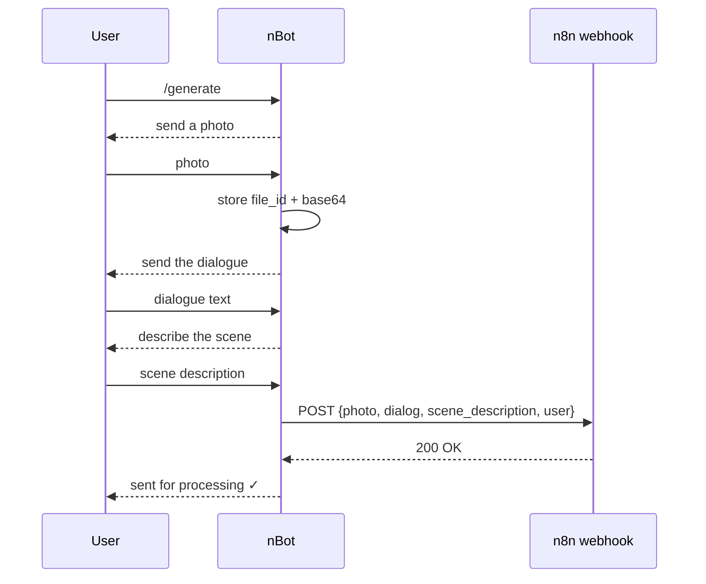

# nBot — Telegram data collector for n8n

A Telegram bot that walks a user through a short three-step form — a **photo**, a **dialogue text** and a **scene description** — and sends the collected data to an **n8n webhook** for further processing (for example, AI content generation). Built with `ConversationHandler` from python-telegram-bot: every user gets an isolated state machine, and the flow can be cancelled at any step.

## Conversation flow



## Data flow



## Commands

| Command | Description |
|---|---|
| `/start` | welcome message |
| `/generate` | start a new submission |
| `/cancel` | cancel at any step |

## Tech stack

Python 3.10+, python-telegram-bot 21, aiohttp, python-dotenv, pytest, Docker.

## Getting started

```bash
pip install -r requirements.txt
cp .env.example .env   # TELEGRAM_TOKEN and N8N_WEBHOOK_URL
python bot.py
```

With Docker:

```bash
docker compose up -d
```

Tests:

```bash
pytest
```

More docs: [`QUICKSTART.md`](QUICKSTART.md), [`DEPLOYMENT.md`](DEPLOYMENT.md), [`EXAMPLES.md`](EXAMPLES.md), [`PROJECT_STRUCTURE.md`](PROJECT_STRUCTURE.md).
